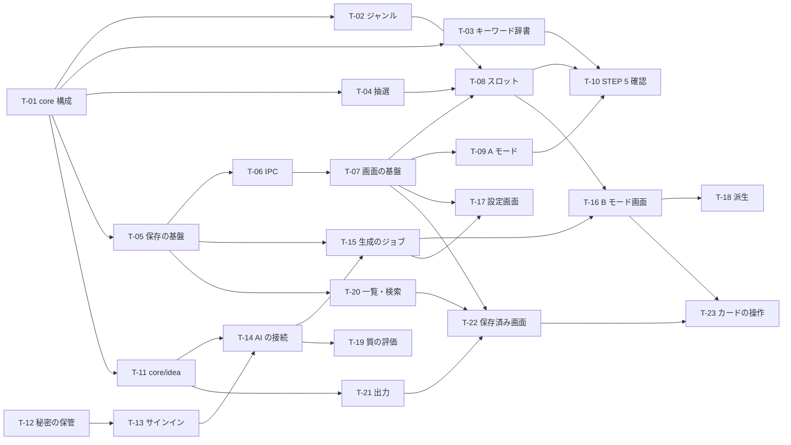

# STEP 4 MVP のタスク分解

- 作成: 2026-11-05
- 前提: [企画書 §15](../spec/game-idea-lab-v0.1.md)（MVP 13 項目）、[設計 02〜04](02-architecture.md)、メンテナーの判断 Q-4（API キー）・Q-5（派生）
- タスクの状態の正本はこの文書の表。着手・完了したら「状態」を書き換え、STATE.md の「最近の変更」に 1 行足す。

## 1. 完了の条件（全タスク共通）

1. 受け入れ条件を満たす。
2. `npm run check`（型検査・テスト・公開前の検査）が通る。`src/core` と `src/main/storage` などロジックの変更にはテストを足す。
3. 画面の変更は `npm run dev` で起動して確かめる。
4. 分かったことがあれば LEARNINGS に書く。STATE.md を更新する。

大きさの目安: S = 半日以内、M = 1 日前後、L = 2〜3 日。

## 2. タスクの一覧

### STEP 5: 抽選と A モード（AI なし・オフラインで完結）

| ID | タスク | 大きさ | 依存 | 受け入れ条件 | 状態 |
|---|---|---|---|---|---|
| T-01 | `src/core` の構成を整える（`dictionary/`・`random.ts`・各 `index.ts`）。今の `dictionary.ts` を移す | S | — | 既存のテストが通る。`src/core` が Electron・React・Node を import していないことをテストで検査する | 未着手 |
| T-02 | ジャンルの辞書を親カテゴリ 5 つに組み替える（design/04 §1.3） | S | T-01 | 20 ジャンルがどれか 1 つの親に入る。「その他」が無い | 未着手 |
| T-03 | 一般キーワードの辞書を作る（10 カテゴリ × 100 語、最低 60 語）。辞書の検査に長さ・空白・記号の規則を足す | M | T-01 | 検査が通る。カテゴリごとの語数を README か辞書の説明に書く。**メンテナーが抜き取りで眺めて了承** | 未着手 |
| T-04 | 抽選（`src/core/draw`。design/04 §1.1〜1.2） | M | T-01 | 固定の乱数で D-1〜D-4 を検査。1 万回の抽選でカテゴリの出方が均等（許容の幅を決めて検査）。同じ組み合わせにキーワードの重複が無い | 未着手 |
| T-05 | 保存の基盤（`src/main/storage`: `db.ts`・マイグレーション版 1・起動時の控え・設定と作業状態の読み書き・A モードの案の追加） | M | T-01 | `:memory:` の DB で、マイグレーション・設定・作業状態・案の追加をテスト。控えが 7 つまで残る | 未着手 |
| T-06 | IPC の契約と入力の検査（作業状態・設定・`saveHumanIdea`）、preload | S | T-05 | 不正な入力（長すぎる・型が違う）を main が拒否するテスト | 未着手 |
| T-07 | 画面の基盤（`AppState`・`AppShell`・画面の切り替え・テーマ・ウィンドウの大きさの記憶・作業状態の自動保存） | M | T-06 | 再起動してもモード・組み合わせ・固定・下書きが戻る。ライト・ダーク・システムが切り替わる | 未着手 |
| T-08 | メイン画面の上部（`SlotCard`・`CategoryPicker`・`DrawBar`・キー操作・演出・組み合わせのコピー） | L | T-02・T-04・T-07 | design/03 §2.1〜2.2・2.5・2.6 のとおりに動く。固定が一目で分かる。連打しても固まらない | 未着手 |
| T-09 | A モード（`HumanIdeaPanel`。下書きの自動保存・書き始めの組み合わせ・保存） | S | T-07 | design/03 §2.3 のとおり。保存した案が DB に入る | 未着手 |
| T-10 | STEP 5 の確認（ネットワークを切って抽選・A モード・保存が動く。手で確かめる項目を `docs/design/06-manual-checks.md` に書く） | S | T-03・T-08・T-09 | 確認の結果を STATE に書く | 未着手 |

### STEP 6: AI 連携と B モード

| ID | タスク | 大きさ | 依存 | 受け入れ条件 | 状態 |
|---|---|---|---|---|---|
| T-11 | アイデアの型と生成の部品（`src/core/idea`: 項目・JSON Schema・方向の配分・指示文と忠実度・ストリームの部分解析） | M | T-01 | design/04 §3.1〜3.3・3.5 のテスト。途中で切れた JSON から閉じた案だけを取り出せる | 未着手 |
| T-12 | 秘密の保管（`src/main/secrets`。`safeStorage` を差し替えられる形で包む） | S | — | 暗号化できない環境では保存を断り、平文で書かない。テストは偽の `safeStorage` で | 未着手 |
| T-13 | Sign in with ChatGPT（`src/main/auth`: loopback・PKCE・ID トークンの検査・更新の直列化・失効） | L | T-12 | テスト用の鍵で署名した ID トークンの検査、`state` の不一致の拒否、更新の同時呼び出しが 1 回にまとまる。試作の手順で実際にサインインできる（メンテナー） | 未着手 |
| T-14 | AI の接続（`src/main/ai`: SSE の解析・誤りの区別・プランの接続・API キーの接続・モデル一覧の `models`/`slug`） | L | T-11・T-13 | 試作で記録した形の SSE を流すテストで、案のイベント・完了・各種の誤り（調査 §6）が区別される | 未着手 |
| T-15 | 生成のジョブ（同時に 1 つ・中止・履歴への保存・履歴を 200 件に保つ）と IPC（`ai.*`・`auth.*`） | M | T-05・T-14 | 中止すると未完成の案が残らない。履歴が 200 件を超えない | 未着手 |
| T-16 | B モードの画面（`AiIdeaPanel`・`IdeaCard`・骨組みのカード・誤りの表示・未接続の案内・`PlanNotice`） | L | T-08・T-15 | design/03 §2.4・§5 のとおり。生成中も抽選と A モードが使える | 未着手 |
| T-17 | 設定画面（AI の接続・API キー（Q-4）・モデル・案の数・忠実度・テーマ） | M | T-07・T-15 | design/03 §4 のとおり。API キーは読み出せない。自動で接続を切り替えない | 未着手 |
| T-18 | 派生生成（Q-5。指示文・`ai.derive`・`DeriveMenu`） | M | T-16 | 5 つの操作で新しい案ができ、元が書き換わらない。元が分かる表示 | 未着手 |
| T-19 | 生成の質の評価（評価用の組み合わせ 10 通り・`tools/eval-ideas.mjs`・指示文の調整） | M | T-14 | 評価の結果を `private/eval/` に残し、指示文を変えた理由を LEARNINGS に書く。**メンテナーのサインインが要る** | 未着手 |

### STEP 7: 保存・一覧・出力

| ID | タスク | 大きさ | 依存 | 受け入れ条件 | 状態 |
|---|---|---|---|---|---|
| T-20 | 案の一覧・検索・更新・削除（`ideaRepository`。お気に入りで自動的に保存済み） | M | T-05 | design/04 §4 の検索・履歴の削除・お気に入りの規則のテスト | 未着手 |
| T-21 | 出力（`src/core/export` の Markdown・コピー・`exportMarkdownFile` の保存ダイアログ） | S | T-11 | design/04 §5 の形のテスト（メモが空なら節が無い、A モードの案、複数の案） | 未着手 |
| T-22 | 保存済み画面と詳細（`SavedScreen`・`IdeaDetail`・メモ・複数選択の出力・削除の確認） | L | T-07・T-20・T-21 | design/03 §3 のとおり | 未着手 |
| T-23 | メイン画面のカードの操作をつなぐ（お気に入り・保存・コピー・詳細） | S | T-16・T-20・T-21・T-22 | B モードのカードから保存・コピー・詳細ができる | 未着手 |

### STEP 8: 全体の確認と配布の準備

| ID | タスク | 大きさ | 依存 | 受け入れ条件 | 状態 |
|---|---|---|---|---|---|
| T-24 | 全体の確認（手で確かめる項目の実施: オフライン・ダーク・幅 960・誤りの表示・再起動・控え） | M | STEP 5〜7 | 結果を `06-manual-checks.md` と STATE に書く | 未着手 |
| T-25 | 配布の形を決めて作る（U-5: インストーラー・アイコン・依存のライセンス表記） | M | T-24 | Windows にインストールして起動できる。**メンテナーが配布の形を判断** | 未着手 |
| T-26 | 公開の準備（`SECURITY.md`・英語の README の要約・`package.json` の `repository`・CI の確認・Sign in with ChatGPT の配布の条件の確認（U-7）） | S | T-25 | 公開前の検査が通る。**公開するかどうか・いつかはメンテナーが決める** | 未着手 |

## 3. 依存関係

- 一番長い道筋: T-01 → T-05 → T-06 → T-07 → T-08 → T-16 → T-23 → T-24 → T-25。画面の基盤（T-07）と B モードの画面（T-16）が要。
- 並べて進められるもの:
  - T-03（辞書づくり）は他と独立。早めに始めてメンテナーの了承をもらう。
  - T-11・T-12・T-13（AI の部品）は STEP 5 の画面と並べて進められる。
  - T-20・T-21（一覧と出力のロジック）は T-05 の後いつでも。
- 企画書 §19 の順（抽選と A モード → AI → 保存・出力）は守る。並べて進めるのは画面に出ない部品だけにし、STEP 5 の確認（T-10）を先に終える。

## 4. メンテナーに手を借りるところ

| タスク | 必要なこと |
|---|---|
| T-03 | 辞書の抜き取りの確認（偏り・面白さ） |
| T-13・T-19 | ChatGPT アカウントでのサインイン |
| T-10・T-24 | 触ってみての感想（「もう一回回したい」か） |
| T-25・T-26 | 配布の形、公開の判断 |

## 5. MVP 13 項目との対応

| 企画書 §15 | タスク |
|---|---|
| 1 Windows デスクトップアプリ | T-07・T-25 |
| 2 3 スロットの抽選 | T-04・T-08 |
| 3 スロットごとのカテゴリ選択 | T-08 |
| 4 複数カテゴリ選択 | T-04・T-08 |
| 5 固定・個別再抽選 | T-04・T-08 |
| 6 A/B モード | T-07・T-09・T-16 |
| 7 A モードの自由入力 | T-09 |
| 8 B モードの複数案生成 | T-11・T-14〜T-16 |
| 9 Sign in with ChatGPT | T-12・T-13・T-17 |
| 10 アイデア保存 | T-05・T-09・T-20 |
| 11 お気に入り | T-20・T-23 |
| 12 保存済み一覧 | T-22 |
| 13 コピー・Markdown | T-21・T-23 |
| （Q-5）派生 | T-18 |
| （Q-4）API キー | T-14・T-17 |
